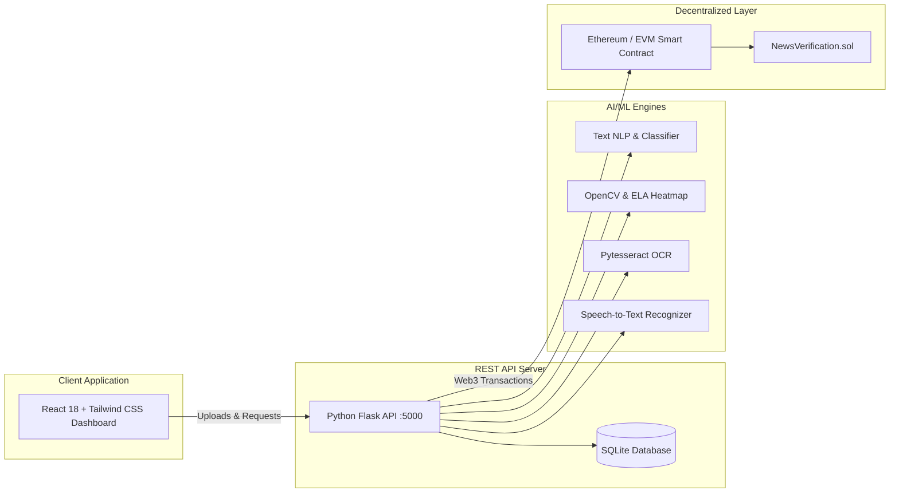

# VeritasChain: AI-Based Fake News Detection System Using Blockchain

[](https://soliditylang.org/)
[](https://ethereum.org/)
[](https://python.org/)
[](https://flask.palletsprojects.com/)
[](https://react.dev/)
[](https://tailwindcss.com/)

A modern, enterprise-grade, multi-modal Fake News Detection platform that analyzes news authenticity across **Text**, **Images**, **Audio**, and **Video** using AI, Machine Learning, NLP, OCR, Speech Recognition, and Computer Vision—cryptographically anchored into an **Ethereum smart contract** for immutable tamper-proof verification.

---

## 🌟 Key Features

### 1. Multi-Modal AI Detection
- **Text News Analyzer**:
  - Natural Language Processing (NLP) linguistic profiling.
  - TF-IDF feature extraction with Scikit-Learn calibrated classifier.
  - Sensationalism score, sentiment polarization, clickbait syntax, and publisher credibility ranking.
- **Image News Analyzer**:
  - Optical Character Recognition (OCR) text layer extraction (`pytesseract` + OpenCV heuristic fallback).
  - Error Level Analysis (ELA) difference heatmap generator revealing compression anomalies and photoshopped splices.
  - EXIF metadata software signature detection.
- **Audio News Analyzer**:
  - Speech-to-Text (STT) transcription via Google Speech Recognition API.
  - Acoustic signal parameters: dynamic range, sample rate, and synthetic cloned voice anomaly score.
  - Spoken claim veracity analysis.
- **Video News Analyzer**:
  - Automated OpenCV keyframe sampling across video duration.
  - Per-frame sharpness variance and tamper detection heatmap.
  - Integrated audio speech transcription and multi-modal weighted fusion.

### 2. Mathematically Grounded Scoring
- **Veracity Probabilities**: Clearly displays complementary percentage probabilities:
  $$\text{Fake News \%} + \text{Real News \%} = 100\%$$
- **Epistemic Confidence**: Strictly distinguished from factual probability:
  $$\text{Confidence \%} \in [0, 100]$$
  Measures evidence richness, signal convergence, and sensor clarity.
- **Categorical Verdicts**:
  - **`REAL`**: When Real probability $\ge 58\%$ with adequate confidence.
  - **`FAKE`**: When Fake probability $\ge 58\%$ with adequate confidence.
  - **`UNVERIFIED`**: When confidence $< 45\%$ or evidence signals are contradictory.
- **Forensic Breakdown**: Human-readable explanations citing specific linguistic, acoustic, or visual manipulation indicators.

### 3. Blockchain Immutability (Solidity & Ethereum)
- **`NewsVerification.sol`**: EVM smart contract storing content hashes, verdicts, scores, timestamps, and verifier signatures.
- **Cryptographic Hashes**: Every submission generates a unique SHA-256 / Keccak-256 hash.
- **Public Blockchain Explorer**: Anyone can paste a content hash or transaction ID to verify whether an article or image has been modified since it was audited.
- **Digital Certificate of Authenticity**: Printable on-chain certificate featuring block heights, gas used, and cryptographic proof of zero tampering.

---

## 🏗️ Architecture Overview



---

## 🚀 Quick Start (Windows VS Code)

### Prerequisites
- **Python 3.10+** (Python 3.14 supported)
- **Node.js v18+** & **npm**

### Option A: One-Click Launch (Recommended)
Double-click `start_all.bat` in the project root:
```bat
start_all.bat
```
This automatically launches the Flask backend and React frontend in separate terminals and opens your browser.

---

### Option B: Manual Setup via VS Code Terminal

#### 1. Start the Flask Backend
Open a terminal in VS Code:
```powershell
cd backend
python -m pip install -r requirements.txt
python app.py
```
> Backend runs at `http://127.0.0.1:5000`

#### 2. Start the React Frontend
Open a second terminal split in VS Code:
```powershell
cd frontend
npm install
npm run dev
```
> Frontend runs at `http://localhost:5173`

---

## 🧪 Testing the Multi-Modal Engines

Sample files are pre-generated in `backend/uploads/` for instantaneous testing:
1. **Text**: Open the **Text News Analyzer** and click any of the 3 quick benchmark presets ("5G Mind Control Rumor", "Federal Reserve Rates", "Speculative Rumor").
2. **Image**: In **Image News Analyzer**, upload `backend/uploads/sample_fake_explosion.jpg` to observe the Error Level Analysis (ELA) tampering heatmap in real-time.
3. **Audio**: In **Audio News Analyzer**, upload `backend/uploads/audio/sample_audio_announcement.wav` to test speech recognition and acoustic analysis.
4. **Video**: In **Video News Analyzer**, upload `backend/uploads/videos/sample_video_clip.mp4` to observe automated OpenCV keyframe extraction and per-frame tamper auditing.
5. **Blockchain**: In **Blockchain Verification**, paste any sample hash (e.g. `0x89e2c4d9a117d3d198031ba048e7e127391dfcfcf9f67a29e92d775196f7c001`) to inspect its on-chain Certificate of Authenticity.

### Running Automated Test Suite
```powershell
cd backend
python test_system.py
```
Output:
```
Ran 6 tests in 0.381s
OK
```

---

## 📁 Project Structure

```
fake/
├── backend/
│   ├── app.py                      # Flask REST server & endpoints
│   ├── config.py                   # Configuration & paths
│   ├── database.py                 # SQLite storage & benchmark data
│   ├── generate_samples.py         # Sample media generator
│   ├── test_system.py              # Automated test suite
│   ├── requirements.txt            # Python dependencies
│   ├── blockchain/
│   │   ├── web3_client.py          # Web3 client & Cryptographic EVM ledger
│   │   ├── contract_abi.json       # NewsVerification contract ABI
│   │   └── contracts/
│   │       └── NewsVerification.sol # Solidity smart contract
│   ├── models/
│   │   ├── scoring_engine.py       # Mathematical calibration & confidence logic
│   │   ├── text_analyzer.py        # NLP, TF-IDF & sensationalism model
│   │   ├── image_analyzer.py       # OCR & Error Level Analysis (ELA)
│   │   ├── audio_analyzer.py       # Speech-to-Text & acoustic voice forensics
│   │   └── video_analyzer.py       # OpenCV keyframe extraction & fusion
│   └── uploads/                    # Generated heatmaps, frames, audio & video
├── frontend/
│   ├── package.json
│   ├── vite.config.js
│   ├── tailwind.config.js
│   ├── src/
│   │   ├── App.jsx                 # Main layout & routing
│   │   ├── components/
│   │   │   ├── Navbar.jsx          # Top search & status
│   │   │   ├── Sidebar.jsx         # Section navigation
│   │   │   ├── StatCard.jsx        # Metric widgets
│   │   │   ├── ResultCard.jsx      # Verdict & percentage display
│   │   │   ├── VerificationCertificate.jsx # Printable on-chain certificate
│   │   │   └── BlockchainBadge.jsx # Transaction pill
│   │   └── pages/
│   │       ├── DashboardOverview.jsx # Analytics & interactive charts
│   │       ├── TextAnalyzer.jsx    # Text news analysis
│   │       ├── ImageAnalyzer.jsx   # Image OCR & ELA heatmaps
│   │       ├── AudioAnalyzer.jsx   # Speech transcription & acoustics
│   │       ├── VideoAnalyzer.jsx   # Keyframe extraction & multi-modal verdict
│   │       ├── BlockchainLedger.jsx# Ledger & hash verification
│   │       └── SmartContractView.jsx# Solidity code & ABI inspector
├── scripts/
│   └── deploy_contract.py          # Smart contract deployer
├── start_all.bat                   # 1-click startup script
├── run_backend.bat                 # Backend runner
├── run_frontend.bat                # Frontend runner
└── README.md
```

---

## 📄 License
MIT License - 2026 VeritasChain Protocol.
